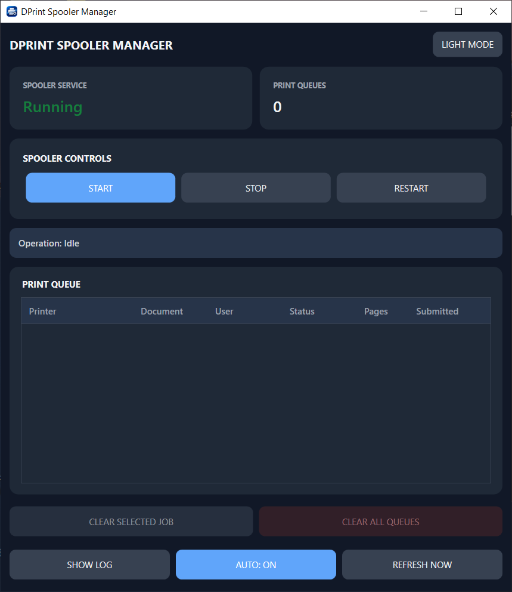
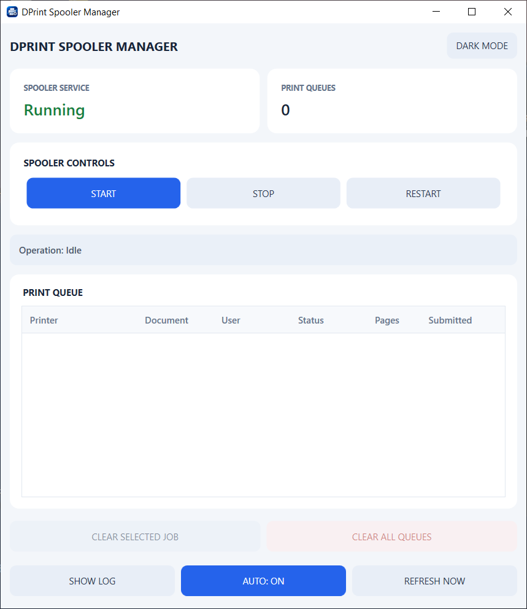
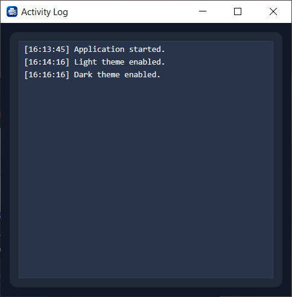
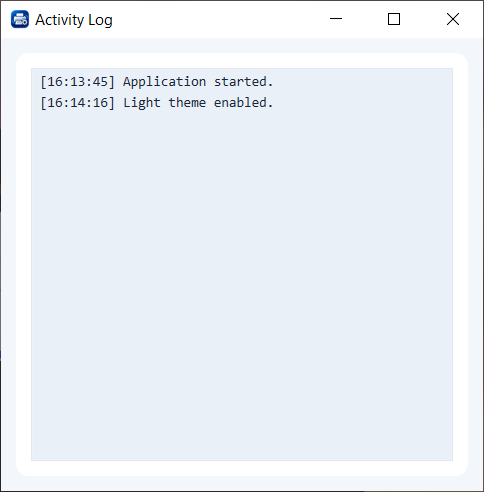

# DPrint Spooler Manager

A lightweight Windows utility for monitoring and managing the Windows Print Spooler service and print queues.

## Screenshots

### Main Window

**Dark Mode**



**Light Mode**



### Activity Log

**Dark Mode**



**Light Mode**



> **Project status:** v1.0 baseline  
> **Platform:** Windows  
> **Framework:** WPF / .NET 10

## Features

- View the Windows Print Spooler service status.
- Start, stop, and restart the Print Spooler service.
- Monitor print jobs with automatic refresh (3-second interval).
- Manually refresh the print queue.
- View printer, document, user, status, page count, and submission time.
- Remove only the selected print job.
- Clear all jobs for the selected printer.
- Clear all print queues.
- View the activity log in a separate window.
- Switch between Dark and Light themes.
- Sort print queue columns.

## Requirements

- Windows 10 or later (the app uses Windows-specific print and service APIs).
- .NET 10 SDK to build from source.
- Administrator privileges for service control and print-job deletion.

## Build and run

Clone the repository, open a terminal in the project directory, then run:

```powershell
dotnet restore
dotnet build
dotnet run
```

The application requests Administrator permission at startup because some operations require elevation.

## Important notes

- The application uses Windows Management Instrumentation (WMI) to inspect and manage print jobs.
- The application uses `ServiceController` to control the Windows Print Spooler service.
- Clearing or deleting print jobs is destructive: pending jobs may be permanently removed. Review the selected action and confirmation prompt before proceeding.
- The sort arrow indicator in the queue table header is a known visual issue in this baseline. Column sorting itself is available; the indicator may not be visible.

## Screenshots

Screenshots will be added after the repository branding and release assets are finalized.

## Project structure

```text
.
├── Models/
├── Services/
├── App.xaml
├── MainWindow.xaml
├── LogWindow.xaml
├── DPrintSpoolerManager.csproj
└── DPrintSpoolerManager.ico
```

The project and C# namespace use the `DPrintSpoolerManager` identity. The user-facing product and executable name are **DPrint Spooler Manager**.

## Disclaimer

DPrint Spooler Manager is an independent project and is not affiliated with, endorsed by, or supported by Microsoft or any printer manufacturer. Windows is a trademark of Microsoft Corporation.

## Acknowledgements

Developed by Sebastian with ChatGPT as an AI learning, design, and development companion.

The application icon was created with the assistance of OpenAI ChatGPT. Project direction, decisions, implementation, testing, and final integration are managed by the project maintainer.

ChatGPT is an AI product by OpenAI. This acknowledgement does not imply endorsement of DPrint by OpenAI.

## License

This project is licensed under the **Apache License 2.0**. See the [`LICENSE`](LICENSE) file for the complete license text.

Unless a file or component states otherwise, the project source code is distributed under Apache-2.0. Third-party dependencies and assets remain subject to their respective licenses and terms. The DPrint name and branding are not granted as trademarks by this software license.
